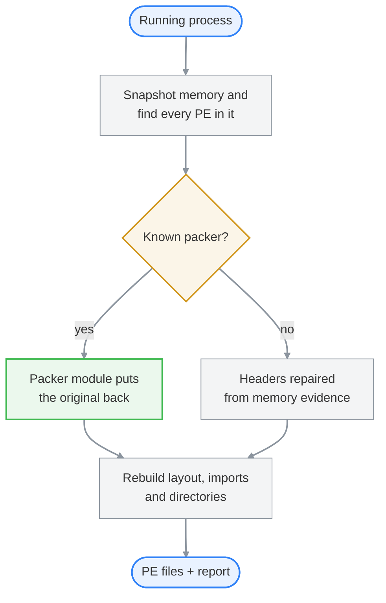

<p align="center">
  
</p>

<p align="center">
  <b>Pull every EXE and DLL out of a running Windows process and get back PE files your tools can actually open.</b>
</p>

<p align="center">
  <a href="https://github.com/techlinn/MemPE/actions/workflows/ci.yml"></a>
  <a href="https://github.com/techlinn/MemPE/releases/latest"></a>
  <a href="https://github.com/techlinn/MemPE/releases"></a>
  
  <a href="LICENSE"></a>
</p>

<p align="center">
  <a href="https://github.com/techlinn/MemPE/releases/latest">Download</a> ·
  <a href="#usage">Usage</a> ·
  <a href="#supported-packers">Packers</a> ·
  <a href="#limitations">Limitations</a>
</p>

---

Packers can hide a program on disk all they want. The moment it runs, the real thing has to be sitting in memory, and that's where mempe grabs it.

It takes every module in the process, lays each one back out the way a file on disk expects, rebuilds the imports, and writes PE files that IDA, Ghidra or your favorite debugger will open without complaining. If it knows the packer, it goes a step further and hands you the original program back.

Here it is on a UPX-packed crackme that's sitting at its password prompt:

```text
> mempe.exe -p 28884

TARGET
  Name       upx_packed_binary.exe
  Arch       x64

OUTPUT
  Main       .\mempe\upx_packed_binary.exe
  Entry      0x00002700 (.text, unwind-covered)
  Packer     UPX 5.30, restored headers, entry point, imports, relocations, resources, debug directory (CodeView entry)
  Lost       debug entries the packer erased
  DLLs       29

DONE  Analysis-ready memory images
```

`UPX0` and `UPX1` are gone. What comes out is the program as it was compiled, with its real entry point and import table. The `Lost` line is mempe being upfront: UPX deleted those debug entries when it packed the file, so nobody can bring them back.

## What you get

- Every EXE and DLL in an x86 or x64 process, rebuilt from its in-memory layout into a normal PE file
- Imports put back together, even when the packer trashed the import table
- PEs that were mapped by hand or stashed in random memory, the kind the module list never shows you
- Packers undone when mempe knows them (see [the table](#supported-packers))
- For UPX, ASPack, MPRESS, PECompact and FSG, a second copy that starts on its own, built with the data the program began with
- A report that tells you what it couldn't recover, so a broken dump never passes itself off as a good one

## How it works



mempe snapshots the process, finds every module plus any PE hiding in non-image memory, and checks each one against its packer modules. A packer it knows gets undone properly. Anything else is repaired from what the memory shows. Either way, the image is rebuilt into file layout, its imports are recovered, and you get a PE file plus a report.

## Supported packers

| Packer | Status | Versions |
|---|---|---|
| UPX | Supported | Every release from 3.91 to 5.3.0 |
| ASPack | Supported | 1.07b, 2.11, 2.12, 2.2, 2.24, 2.28, 2.29, 2.43 |
| MPRESS | Supported | 1.05, 1.27, 2.05, 2.19 |
| PECompact | Supported | 2.3, 2.67 and 3.11, plus five other 2.x builds from 2005 and 2006 |
| FSG | Supported | 1.0, 1.1, 1.2, 1.3, 1.31, 1.33, 2.0 and modified stubs |
| VMProtect | Planned | - |
| Themida / WinLicense | Planned | - |
| Code Virtualizer | Planned | - |
| Enigma Protector | Planned | - |
| Obsidium | Planned | - |
| ASProtect | Planned | - |
| Armadillo | Planned | - |
| PELock | Planned | - |
| Safengine Shielden | Planned | - |
| EXECryptor | Planned | - |
| Petite | Planned | - |
| MEW | Planned | - |
| nPack / NsPack | Planned | - |
| kkrunchy | Planned | - |
| WinUpack | Planned | - |
| MoleBox | Planned | - |
| Anything else | Generic dump | Any |

Anything missing? [Open an issue](https://github.com/techlinn/MemPE/issues) and I'll add it.

Each packer lives in its own file under [`src/pe/packers/`](src/pe/packers), so adding one doesn't touch the rest of the tool.

## Usage

Grab `mempe-windows-x86_64.zip` from the [latest release](https://github.com/techlinn/MemPE/releases/latest). It's one exe with nothing to install, and it dumps 32-bit and 64-bit processes alike.

Dump a running process by PID (hex works too, like `0x1078`):

```text
mempe.exe -p 4216
```

Or have mempe wait for a program to launch and grab it once it has settled:

```text
mempe.exe -w target.exe
```

| Option | What it does |
|---|---|
| `-e`, `--entry-point <rva>` | You already found the OEP? Tell mempe and it uses that |
| `--only <name or base>` | Only write the images you care about. Everything is still captured, so imports resolve the same |
| `--raw-regions` | Also save executable memory with no PE in it, like shellcode |
| `-h`, `--help` | Shows the help |

Everything lands in a `mempe` folder in the current directory.

A dump keeps the data exactly as it was while the program ran, decrypted strings and all, so a program that sets itself up at startup usually crashes if you start the dump. For UPX, ASPack, MPRESS, PECompact and FSG, mempe can read the data the program started with out of the packed file. When the running data differs, it asks once whether to also save a copy like `target.fresh.exe` that starts on its own. The main dump never changes. When nobody is there to answer, like in a script, it saves the copy.

To build it yourself, you need Windows 10 or later and stable Rust:

```text
cargo build --release
```

> [!CAUTION]
> mempe dumps a process that's already running, so whatever you're dumping has to run first. If it's malware, do this in a VM.

## Limitations

- Let the program unpack itself before you dump it. Go too early and you'll get the packed bytes back, though mempe will warn you when a section looks like it was never decrypted.
- Only x86 and x64 Windows PE files are supported.
- mempe needs permission to read the target. Elevated targets need an elevated terminal, and protected processes can still say no.
- Heavy API hashing or custom loaders can leave some imports unresolved. mempe counts those instead of dropping them quietly.
- Dumps are for static analysis. Getting one to run again can take some manual work, unless mempe gave you a `.fresh` copy.

## When to reach for something else

mempe is about getting clean files out of a process. If you want to sweep processes for injected or modified code, [pe-sieve](https://github.com/hasherezade/pe-sieve) and [hollows_hunter](https://github.com/hasherezade/hollows_hunter) are built for exactly that. If you're already stepping through a target in [x64dbg](https://github.com/x64dbg/x64dbg), its built-in [Scylla](https://github.com/NtQuery/Scylla) is the quickest way to fix imports by hand at the point you stopped.

## Exit codes

| Code | Meaning |
|---|---|
| `0` | The main image and all known DLLs were rebuilt |
| `1` | Invalid arguments, cancelled output, or output setup failed |
| `2` | The target could not be queried, captured, or written |
| `3` | Some output was written, but the main image or one or more DLLs failed |

## Issues and contributing

Hit a bug, a dump that came out wrong, or a packer mempe should know about? [Open an issue](https://github.com/techlinn/MemPE/issues) and I'll take a look. If you're reporting a bad dump, the console output helps a lot, and so does the packer or protector the target was built with.

Pull requests are welcome too. A new packer is a good place to start, since each one lives in its own file under [`src/pe/packers/`](src/pe/packers).

MIT licensed. See [LICENSE](LICENSE).
